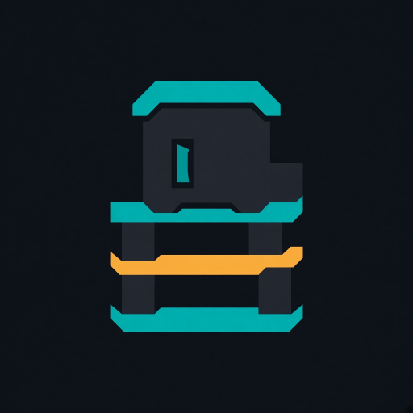

<p align="center">
  
</p>

<h1 align="center">ROM Emulator</h1>

<p align="center">
  <strong>Lanzador de ROMs para Windows</strong><br />
  Catálogo remoto · estantería TV · emuladores · carátulas originales
</p>

<p align="center">
  
  
  
  
</p>

---

## Qué es

**ROM Emulator** orquesta tres capas en una sola experiencia de escritorio:

| Capa | Rol |
|------|-----|
| **API Flask** (`scripts/rom_web`) | Búsqueda y descarga vía CoolROM / RomsFun |
| **Boxshelf (fork)** (`tools/boxshelf`) | UI tipo estantería + **Wanikoko Loader** |
| **Emuladores & arte** | Instalación (RetroArch, PCSX2, DuckStation, …) y carátulas LaunchBox / Libretro |

Buscas un título, lo descargas sin bloquear la UI, se cablea el emulador correcto y el juego aparece en el estante con carátula retail.

---

## Arranque en 30 segundos

```bat
lanzar_boxshelf.bat
```

Equivalente:

```bat
.venv\Scripts\python.exe lanzar_boxshelf.py
```

El orquestador:

1. Levanta la API en `http://127.0.0.1:5000`
2. Espera a que `/api/health` responda
3. Abre Boxshelf (`electron` en `tools/boxshelf`)

**Escritorio:** acceso directo **ROM Emulator** → `lanzar_boxshelf.bat`  
**Icono:** `assets/rom-emulator.ico` · **Logo:** `assets/logo.png`

---

## Requisitos

| Componente | Detalle |
|------------|---------|
| SO | Windows 10 / 11 |
| Python | 3.11+ con `.venv` (`pyproject.toml` / `uv`) |
| Node.js | npm — primera vez: `cd tools/boxshelf && npm install` |

---

## Arquitectura

```text
rom-emulator/
├── lanzar_boxshelf.bat / .py     Orquestador API + UI
├── assets/                       Logo e icono de escritorio
├── scripts/rom_web/              Flask: búsqueda, listado, proxy
│   ├── web_app.py
│   ├── system_map.py             CoolROM/RomsFun ↔ Boxshelf + emus
│   ├── emulators.py
│   └── api_client.py
└── tools/boxshelf/               Fork GPL + Wanikoko Loader
    ├── main/romcatalog.js        Cliente API + descarga/prepare
    ├── main/emuinstall.js        Instalación de emuladores
    ├── main/covers.js            Carátulas LaunchBox / Libretro
    └── renderer/settings.js      UI Wanikoko (Settings → ROM Catalog)
```

### Flujo Wanikoko (añadir un juego)

```text
Buscar → Descargar (job async) → ROMS\<sistema>\
      → Preparar / extraer → Emulador (instalar si falta)
      → Carátula original → Rescan → Play
```

- Resultados únicos con **consola + emulador**
- Un toast al inicio y otro al terminar (sin spam)
- Rutas de ROM y emulador en **absoluto** (RetroArch no hereda el cwd del launcher)
- Descargas vacías o truncadas se rechazan

---

## API local

Base: `http://127.0.0.1:5000`

| Método | Ruta | Descripción |
|--------|------|-------------|
| `GET` | `/api/health` | Salud + recuento de sistemas/emuladores |
| `GET` | `/api/catalog/systems` | Mapa consolas ↔ carpetas ↔ emuladores |
| `GET` | `/api/search?q=&provider=all` | Búsqueda con dedupe y ranking |
| `GET` | `/api/roms?boxshelf_id=&provider=` | Listado por consola |
| `GET` | `/api/url?...` | Resuelve URL CDN |
| `GET` | `/download?...` | Proxy de descarga (sesión) |
| `GET` | `/api/emulators` | Catálogo de emuladores PC |

Proveedores: `coolrom.com`, `romsfun.com`, o `all` en search.

---

## Consolas (extracto)

Definición canónica: `scripts/rom_web/system_map.py`

| Boxshelf id | Carpeta | Emulador |
|-------------|---------|----------|
| `nes` / `snes` / `gba` / `gb` / `megadrive` | `ROMS\NES` … `Genesis` | RetroArch (+ cores) |
| `psx` | `ROMS\PS1` | DuckStation |
| `ps2` | `ROMS\PS2` | PCSX2 |
| `psp` | `ROMS\PSP` | PPSSPP |

---

## Uso en la UI

1. **Settings → ROM Catalog** (Wanikoko)
2. **Test API** → debe mostrar API OK
3. Busca un título o **Console → List**
4. **Download** → espera “On shelf · cover…”
5. Cierra Settings y lanza el juego desde el estante

Carátulas bajo demanda: Settings → Box art (caché en `data/boxart-cache`, fuera de git).

---

## Desarrollo

```bat
:: Solo API
.venv\Scripts\python.exe scripts\rom_web\web_app.py

:: Solo UI (API ya en marcha)
cd tools\boxshelf
npm start
```

### Parches relevantes del fork

| Archivo | Qué aporta |
|---------|------------|
| `main/romcatalog.js` | Descarga async, validación de tamaño, prepare |
| `main.js` | Jobs Wanikoko, emulador, covers con reintento |
| `renderer/settings.js` | UI nativa, dedupe, toasts, consola + emulador |
| `main/covers.js` | Prioriza caja retail frente a hacks |
| `main/paths.js` | Relativas → absolutas respecto al app root |

---

## Qué no entra en el repo

ROMs, BIOS, emuladores instalados, `node_modules`, `.venv` y cachés de carátulas están en `.gitignore`.  
Este repositorio es **privado**.

---

## Licencia y responsabilidad

- Orquestador + API: código del proyecto.
- **Boxshelf** (`tools/boxshelf`): **GPL-3.0** — respeta la licencia upstream al redistribuir.
- ROMs y BIOS: responsabilidad exclusiva del usuario; **no se incluyen** en el repositorio.

---

<p align="center">
  <sub>ROM Emulator · Windows desktop launcher</sub>
</p>
